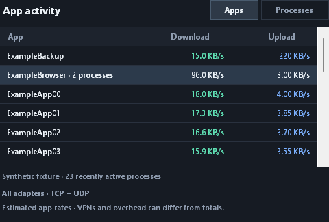

# NetSpeedWidget

[English](#english) · [简体中文](#简体中文)



*Preview uses synthetic data. / 预览使用合成演示数据。*

<a id="english"></a>

## English

A portable, native Windows desktop widget for live download and upload speeds. Keep a compact view on your desktop, or expand it to see which apps and processes are using the network. Built with C# and Windows Forms; no installer or third-party runtime packages are needed. The app's interface labels are currently in English.

### Download and run

1. [Download the portable ZIP from GitHub Releases](https://github.com/Nightingalelyy/network-widget/releases/latest/download/NetSpeedWidget-portable.zip).
2. Extract the whole archive to a folder you can write to.
3. Open `NetSpeedWidget.exe`. Keep `NetSpeedWidget.exe.config` beside it.

**Requirements:** Windows 10 or Windows 11 with .NET Framework 4.8. Compact network totals work without administrator permission. App and process details use Windows system tracing and need administrator permission, requested only when you click **Enable app details**.

Preferences are saved in `settings.xml` beside the executable. Move the extracted folder to move the app and its preferences together.

### Features and controls

- **Live speeds:** Download and upload update about once per second, with a sparkline for each direction showing the latest 60 samples.
- **Desktop placement:** Drag the widget to move it. Right-click or use **⋯** for options, including **Always on top** and **Show in taskbar**.
- **Units:** Switch between bytes per second and bits per second. Prefixes are decimal: the displayed `KB/s` means 1,000 bytes/s; `MB/s` means 1,000,000 bytes/s. One byte equals eight bits.
- **Adapter selection:** Use **Automatic** or select a particular adapter for the compact totals.
- **App details:** Use the arrow button to expand or collapse the app traffic table.
- **Hide and restore:** **Hide to tray** or **Esc** hides the widget. Double-click its notification-area icon to restore it; the icon may be in the hidden-icons menu. Opening the executable again also restores the existing instance.
- **Menu and exit:** **Shift+F10** opens the menu. **Exit** closes the app completely; hiding it keeps the compact monitor running.

### App and process details

Expand the widget, then click **Enable app details** if permission is needed. Windows displays its normal User Account Control prompt and restarts the widget as administrator if approved. Cancelling leaves the existing widget running. Opening the app or expanding the panel alone does not trigger a permission prompt.

**Apps** combines processes with the same executable basename and shows their process count. **Processes** lists each process separately with its process ID (PID). This is name-based grouping, not a product or publisher grouping: differently named helper programs remain separate, and unrelated executables with the same basename can be combined.

The table starts with the busiest combined download/upload rate first. Click **Download** or **Upload** to sort by that direction; click the same header again to reverse the order. Scroll to see more rows. Only traffic observed during the current monitoring session is available.

Process tracing runs while the expanded widget is visible. Collapsing, hiding, minimizing, or exiting stops the session. Restoring an expanded widget starts a fresh measurement period.

### Understanding the readings

| View | Scope | Measurement |
| --- | --- | --- |
| Compact totals | The selected adapter, or automatic adapter selection | Changes in Windows adapter byte counters divided by actual elapsed time |
| App/process table | All adapters; TCP and UDP over IPv4 and IPv6 | Windows network tracing events attributed to processes |

**Automatic** prefers connected physical adapters and combines them when several are active. This avoids adding the same traffic from a physical adapter and its virtual VPN interface. If no physical adapter is available, it falls back to available non-tunnel interfaces, then to other available interfaces. You can select an adapter manually to inspect a particular VPN or virtual interface.

The selected adapter does **not** filter the app table. App rows are not guaranteed to add up to the compact total. Protocol headers, retransmissions, local traffic, virtual interfaces, and sampling boundaries affect the two measurements differently. With a local proxy or VPN, traffic can be attributed to both the originating app and the forwarding process at different stages; summing those rows can count the same logical transfer more than once.

These are current traffic rates, including local network transfers, rather than a connection-capacity test. Short bursts are averaged over the sampling interval. Tracing can also buffer or lose events under load; app-level rates should be treated as approximate.

### Privacy and tracing

The app reads local network counters and, when enabled, local Windows tracing metadata and byte counts. It does not inspect or capture packet payloads, write tracing files to disk, run internet speed-test probes, or send measurements to a remote service. Portable preferences are stored locally in `settings.xml`.

### Build and test

From PowerShell in the repository directory:

```powershell
powershell.exe -NoProfile -ExecutionPolicy Bypass -File .\Build.ps1
powershell.exe -NoProfile -ExecutionPolicy Bypass -File .\Test.ps1
```

The build uses the C# compiler included with .NET Framework, targeting C# 5 and .NET Framework 4.8. It creates `dist\NetSpeedWidget.exe`, its `.exe.config`, and `README.txt`. No separate .NET SDK or package download is required. The execution policy override applies only to the launched PowerShell process.

To build separately while another copy is running:

```powershell
powershell.exe -NoProfile -ExecutionPolicy Bypass -File .\Build.ps1 -OutputDirectory .\staging
```

Relative output paths are resolved from your current PowerShell directory. The default is the repository's `dist` folder. Exit an existing copy before replacing its executable; hiding it does not release the file.

`Test.ps1` compiles three independent test executables in `test-output`:

- **23 measurement tests** across the adapter and process monitors, covering native layouts, manifest and classic event decoding, elapsed-time rates, adapter selection, lifecycle changes, error handling, and native smoke checks.
- **37 UI assertions** using synthetic samples, covering app grouping, PIDs, numeric sorting, selection, scrolling, permission states, units, and 150% display scaling.

The native tracing smoke check reports an expected permission state when run without sufficient access and does not request elevation. Live tracing with administrator permission and the widget's expand/collapse workflow have also been verified on the development PC. These checks do not establish compatibility with every Windows version, device, or network configuration.

### Source map

| File | Responsibility |
| --- | --- |
| [Program.cs](Program.cs) | Startup, single-instance behavior, and administrator restart handoff |
| [WidgetForm.cs](WidgetForm.cs) | Compact widget, tray menu, layout, and monitoring lifecycle |
| [NetworkMonitor.cs](NetworkMonitor.cs) | Native adapter counters and total-rate calculation |
| [ProcessNetworkMonitor.cs](ProcessNetworkMonitor.cs) | Real-time Windows tracing, process attribution, and rates |
| [ProcessTrafficView.cs](ProcessTrafficView.cs) | App grouping, process rows, sorting, and scrolling |
| [Settings.cs](Settings.cs), [SpeedFormatter.cs](SpeedFormatter.cs) | Portable preferences and decimal speed formatting |
| [Build.ps1](Build.ps1), [Test.ps1](Test.ps1) | Explicit source build and independent test suites |
| `*Tests.cs` | Measurement and process-view tests |
| [app.manifest](app.manifest), [NetSpeedWidget.exe.config](NetSpeedWidget.exe.config) | Normal-user startup, system DPI awareness, and runtime configuration |

Adapter readings use Microsoft's [`GetIfTable2`](https://learn.microsoft.com/en-us/windows/win32/api/netioapi/nf-netioapi-getiftable2) and [`MIB_IF_ROW2`](https://learn.microsoft.com/en-us/windows/win32/api/netioapi/ns-netioapi-mib_if_row2). Process readings use real-time [Event Tracing for Windows](https://learn.microsoft.com/en-us/windows/win32/etw/event-tracing-portal) with the built-in `Microsoft-Windows-Kernel-Network` provider in a regular trace session. This avoids the eight-session limit for system loggers that could prevent v1.1.0 from starting app details. The widget does not stop or change tracing sessions owned by other applications.

### Troubleshooting

- **Speeds stay at zero:** Start a network transfer, wait a couple of samples, and check the selected adapter.
- **App details are empty:** Start traffic after opening the panel. Earlier activity is not available. If the panel requests permission, click **Enable app details**.
- **Tracing cannot start:** Read the panel's status message and use **Retry app details** if offered. Compact adapter totals remain available.
- **VPN or proxy figures differ:** Check the measurement scope above. Select the physical adapter for its transport traffic, or a virtual adapter for that interface's counters.
- **Settings are not saved:** Move the portable folder to a location your account can write to. To reset preferences, exit, remove `settings.xml`, and reopen the app.
- **The app does not start:** Verify .NET Framework 4.8 is available and the `.exe.config` file is beside the executable.

[Back to language selection](#netspeedwidget)

---

<a id="简体中文"></a>

## 简体中文

一款便携式原生 Windows 桌面网速小组件，实时显示下载和上传速率。既可以保持紧凑视图，也可以展开查看各个应用和进程的网络活动。使用 C# 和 Windows Forms 开发，无需安装，也无需额外的第三方运行库。应用界面目前使用英文。

### 下载与运行

1. [从 GitHub Releases 下载便携版 ZIP](https://github.com/Nightingalelyy/network-widget/releases/latest/download/NetSpeedWidget-portable.zip)。
2. 将压缩包完整解压到当前账户可写入的文件夹。
3. 打开 `NetSpeedWidget.exe`，并将 `NetSpeedWidget.exe.config` 保留在同一文件夹中。

**运行要求：** Windows 10 或 Windows 11，以及 .NET Framework 4.8。紧凑视图中的网络总速率无需管理员权限。应用和进程详情使用 Windows 系统跟踪，需要管理员权限；只有点击 **Enable app details**（启用应用详情）时才会请求提权。

偏好设置保存在可执行文件旁的 `settings.xml` 中。移动整个解压文件夹，即可同时移动程序和设置。

### 功能与操作

- **实时网速：** 下载和上传速率约每秒更新一次，两条趋势图分别显示最近 60 次采样。
- **桌面位置：** 拖动小组件即可移动。右键或点击 **⋯** 打开选项，其中包括 **Always on top**（窗口置顶）和 **Show in taskbar**（在任务栏显示）。
- **速率单位：** 可在字节/秒与比特/秒之间切换，采用十进制单位：界面中的 `KB/s` 表示每秒 1,000 字节，`MB/s` 表示每秒 1,000,000 字节。1 字节等于 8 比特。
- **网卡选择：** 紧凑视图可使用 **Automatic**（自动选择），也可指定某个网络适配器。
- **应用详情：** 点击箭头按钮展开或收起应用流量表格。
- **隐藏与恢复：** **Hide to tray**（隐藏到托盘）或 **Esc** 可隐藏窗口。双击通知区域图标即可恢复；图标可能位于隐藏图标菜单中。再次打开可执行文件也会恢复已有窗口。
- **菜单与退出：** **Shift+F10** 打开菜单。**Exit** 完全退出程序；隐藏窗口后，紧凑视图的网速监测仍会继续。

### 应用与进程详情

展开小组件后，如果提示需要权限，请点击 **Enable app details**。Windows 将显示标准的用户账户控制提示；批准后，小组件会以管理员身份重新启动。取消提示不会关闭当前小组件。仅启动应用或展开面板不会触发提权提示。

**Apps** 按可执行文件的基本名称合并进程，并显示进程数量；**Processes** 分别列出各个进程及其进程 ID（PID）。这里按名称分组，而非按产品或发布者分组：名称不同的辅助程序会单独显示；名称相同但实际无关的可执行文件也可能被合并。

表格默认按下载与上传速率之和从高到低排序。点击 **Download** 或 **Upload** 可按对应方向排序，再次点击同一表头可反转顺序。滚动表格可查看更多条目。详情仅包含本次监测期间观察到的流量。

进程跟踪仅在展开的小组件可见时运行。收起、隐藏、最小化或退出都会停止跟踪会话。恢复处于展开状态的小组件后，会开始新的测量周期。

### 如何理解读数

| 视图 | 统计范围 | 测量方式 |
| --- | --- | --- |
| 紧凑视图总速率 | 指定的网络适配器，或自动选择的适配器 | Windows 网卡字节计数器的变化量除以实际经过的时间 |
| 应用/进程表格 | 所有适配器上的 IPv4、IPv6 TCP 和 UDP 流量 | 通过 Windows 网络跟踪事件将流量归属到进程 |

**Automatic** 优先选择已连接的物理网卡；多个物理网卡同时活动时，会合并其流量。这样可避免把物理网卡及其虚拟 VPN 接口上的同一份流量重复相加。如果没有可用的物理网卡，则先回退到可用的非隧道接口，再回退到其他可用接口。也可手动选择网卡，单独查看某个 VPN 或虚拟接口。

所选网卡**不会**过滤应用表格。各应用行相加的结果不保证等于紧凑视图的总速率：协议头、重传、本机通信、虚拟接口及采样时间边界对两种测量方式的影响不同。使用本地代理或 VPN 时，同一次传输可能在不同阶段分别归属到原始应用和转发进程；将这些行相加，可能重复计算同一笔逻辑传输。

这些读数表示当前流量速率，包含局域网传输，并非连接的最大带宽或测速结果。短暂突发流量会按采样间隔取平均值。系统负载较高时，跟踪事件也可能延迟或丢失，因此应用级速率应视为近似值。

### 隐私与跟踪

程序读取本机网卡计数器，以及启用详情后的本机 Windows 跟踪元数据和字节数。程序不会检查或捕获数据包载荷，不会将跟踪文件写入磁盘，不会发送互联网测速探测，也不会把测量结果发送到远程服务。便携版偏好设置仅保存在本地 `settings.xml` 中。

### 构建与测试

在仓库目录中打开 PowerShell，运行：

```powershell
powershell.exe -NoProfile -ExecutionPolicy Bypass -File .\Build.ps1
powershell.exe -NoProfile -ExecutionPolicy Bypass -File .\Test.ps1
```

构建脚本使用 .NET Framework 自带的 C# 编译器，目标为 C# 5 和 .NET Framework 4.8。输出包括 `dist\NetSpeedWidget.exe`、对应的 `.exe.config` 和 `README.txt`。无需另行安装 .NET SDK，也无需下载依赖包。执行策略参数仅对本次启动的 PowerShell 进程生效。

如果已有副本正在运行，可构建到其他目录：

```powershell
powershell.exe -NoProfile -ExecutionPolicy Bypass -File .\Build.ps1 -OutputDirectory .\staging
```

相对输出路径以当前 PowerShell 目录为基准，默认输出到仓库中的 `dist` 文件夹。替换正在运行的可执行文件前，请先退出对应程序；仅隐藏窗口不会释放该文件。

`Test.ps1` 会在 `test-output` 中分别编译三个独立的测试程序：

- **23 项测量测试：** 覆盖网卡与进程监测，包括原生结构布局、清单式与传统事件解析、基于实际时间的速率计算、网卡选择、生命周期变化、错误处理和原生接口冒烟检查。
- **37 项界面断言：** 使用合成数据，覆盖应用分组、PID、数值排序、选择状态、滚动、权限状态、单位和 150% 显示缩放。

原生跟踪冒烟检查在权限不足时会报告预期的权限状态，不会请求提权。在开发电脑上，还验证了管理员权限下的实时跟踪以及小组件的展开/收起流程。这些检查并不代表已验证所有 Windows 版本、设备或网络配置。

### 源码结构

| 文件 | 职责 |
| --- | --- |
| [Program.cs](Program.cs) | 启动、单实例行为与管理员重启交接 |
| [WidgetForm.cs](WidgetForm.cs) | 紧凑小组件、托盘菜单、布局与监测生命周期 |
| [NetworkMonitor.cs](NetworkMonitor.cs) | 原生网卡计数器与总速率计算 |
| [ProcessNetworkMonitor.cs](ProcessNetworkMonitor.cs) | 实时 Windows 跟踪、进程归属与速率计算 |
| [ProcessTrafficView.cs](ProcessTrafficView.cs) | 应用分组、进程条目、排序与滚动 |
| [Settings.cs](Settings.cs)、[SpeedFormatter.cs](SpeedFormatter.cs) | 便携版偏好设置与十进制速率格式化 |
| [Build.ps1](Build.ps1)、[Test.ps1](Test.ps1) | 明确列出源文件的构建脚本与独立测试套件 |
| `*Tests.cs` | 测量与进程视图测试 |
| [app.manifest](app.manifest)、[NetSpeedWidget.exe.config](NetSpeedWidget.exe.config) | 普通用户启动、系统 DPI 感知与运行时配置 |

网卡读数使用 Microsoft 的 [`GetIfTable2`](https://learn.microsoft.com/en-us/windows/win32/api/netioapi/nf-netioapi-getiftable2) 和 [`MIB_IF_ROW2`](https://learn.microsoft.com/en-us/windows/win32/api/netioapi/ns-netioapi-mib_if_row2)。进程读数通过实时 [Windows 事件跟踪（ETW）](https://learn.microsoft.com/en-us/windows/win32/etw/event-tracing-portal)，在普通跟踪会话中使用系统内置的 `Microsoft-Windows-Kernel-Network` 提供程序。这避免了系统日志记录器最多八个会话的限制，该限制曾导致 v1.1.0 无法启动应用详情。小组件不会停止或修改其他应用拥有的跟踪会话。

### 常见问题

- **速率一直为零：** 启动一次网络传输，等待几次采样，并确认选择的网卡正确。
- **应用详情为空：** 在打开面板后产生一些网络流量；面板无法显示此前的活动。若提示需要权限，请点击 **Enable app details**。
- **无法启动跟踪：** 查看面板中的状态消息；若显示 **Retry app details**，可点击重试。紧凑视图的网卡总速率仍可使用。
- **VPN 或代理读数不一致：** 请参阅上方的统计范围说明。选择物理网卡可查看其承载流量，选择虚拟网卡可查看对应接口的计数。
- **设置无法保存：** 将便携版文件夹移到当前账户可写入的位置。若需重置设置，请退出程序、删除 `settings.xml`，然后重新打开。
- **程序无法启动：** 确认系统具备 .NET Framework 4.8，且 `.exe.config` 文件与可执行文件位于同一文件夹。

[返回语言选择](#netspeedwidget)
